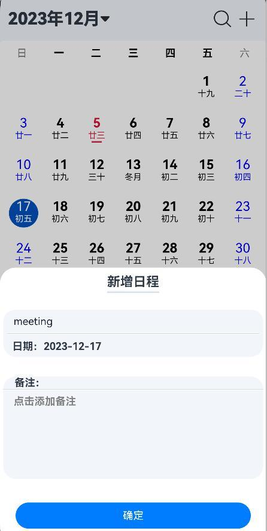
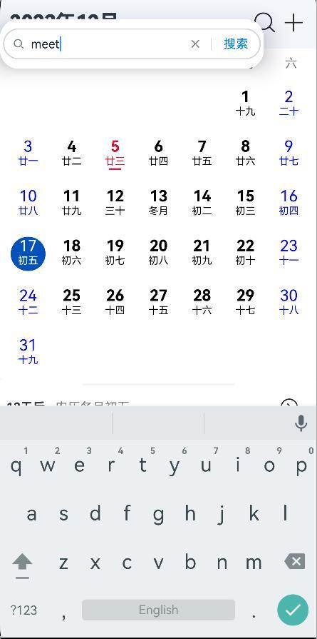

# HarmonyOS 日历与日程管理 App

一款使用 ArkTS 和 ArkUI 开发的 HarmonyOS 日历应用，支持公历与农历月历浏览、日程管理、关键词搜索和系统提醒。日程数据通过 HarmonyOS 关系型数据库保存在设备本地。

## 功能预览

| 新增日程 | 搜索日程 | 系统提醒 |
| --- | --- | --- |
|  |  |  |

## 功能

- 展示公历日期、农历日期与月份视图，支持前后切换月份。
- 选择日期后查看当天日程，新增、编辑和删除日程。
- 按关键词搜索日程，并定位到相关日期。
- 创建系统提醒，在指定时间通知用户。
- 使用 HarmonyOS `relationalStore` 保存日程数据。
- 提供日期详情、农历信息展示和加载失败提示。

## 开发与运行

1. 安装 DevEco Studio 和匹配的 HarmonyOS SDK。
2. 在 DevEco Studio 中打开仓库里的 `calendar/` 工程。
3. 同步项目依赖，选择 HarmonyOS 手机模拟器或设备后构建并运行 `entry` 模块。
4. 首次使用提醒功能时，按系统提示授予日程提醒权限。

日历信息页面会请求第三方节假日接口。仓库中的应用凭据已替换为占位符；如需启用该页面，请自行申请服务商凭据并在本地配置，切勿把密钥提交到公开仓库。移动端内置密钥可被提取，正式产品建议通过自有后端代理该请求。

## 目录结构

```text
calendar/
├── AppScope/                         # 应用级配置与资源
└── entry/
    └── src/main/ets/
        ├── common/database/          # 日程数据表与 relationalStore 封装
        ├── entryability/             # 应用入口
        └── pages/                    # 月历、搜索、日期详情与农历逻辑
```

## 技术栈

- HarmonyOS Stage 模型
- ArkTS、ArkUI
- relationalStore 本地数据持久化
- reminderAgentManager 系统提醒

该项目最初作为 HarmonyOS 移动应用课程项目完成。仓库保留源代码与界面截图；课程报告中的个人信息未纳入仓库。
